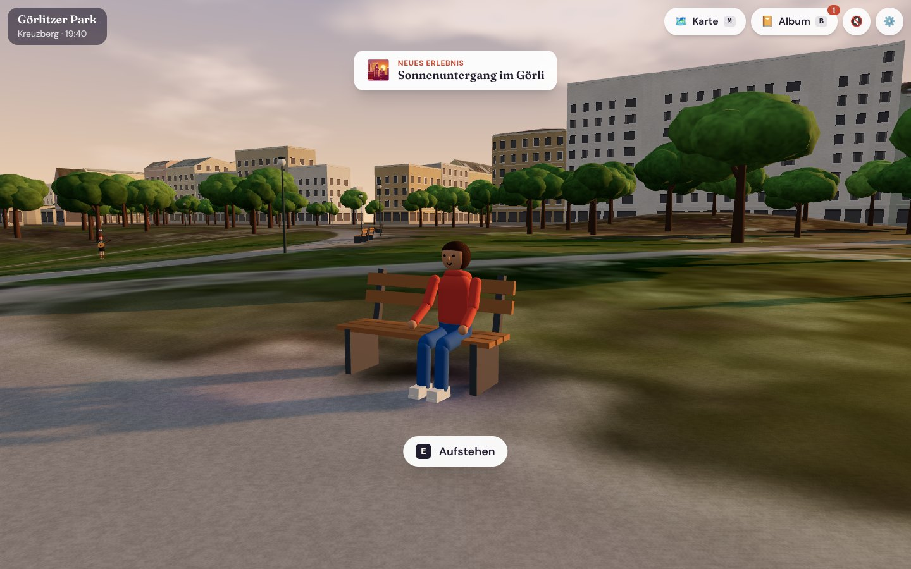
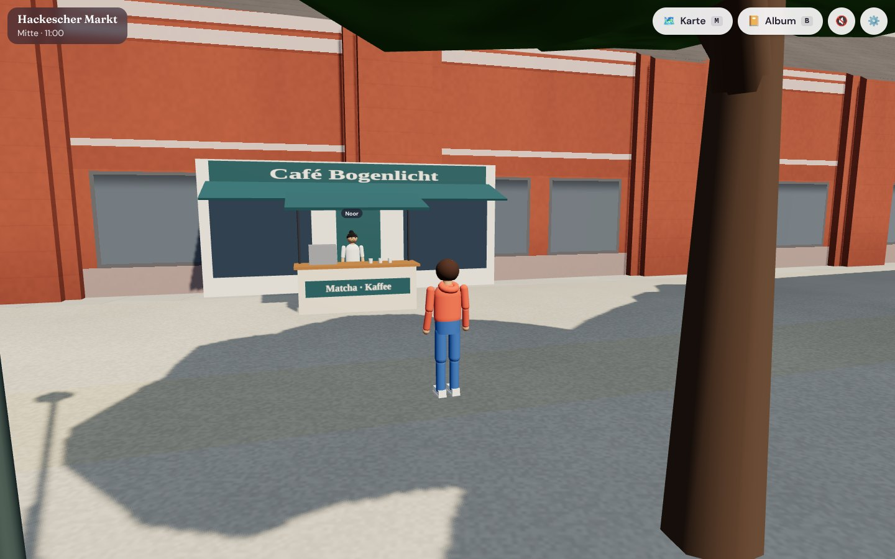
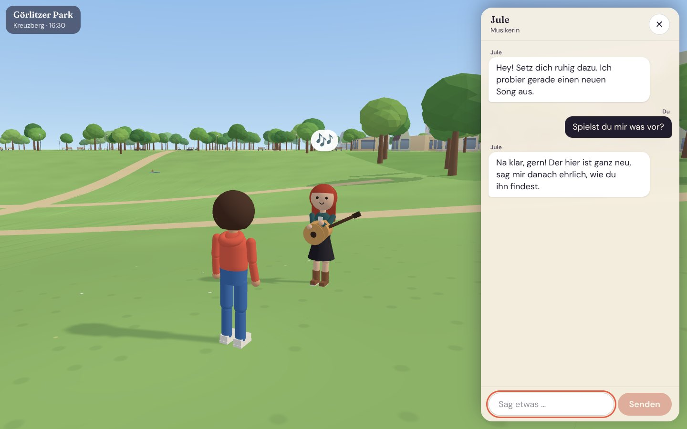
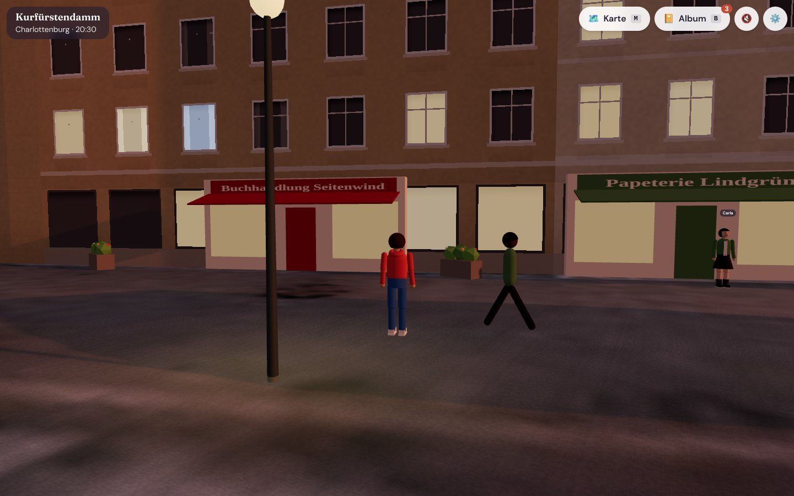
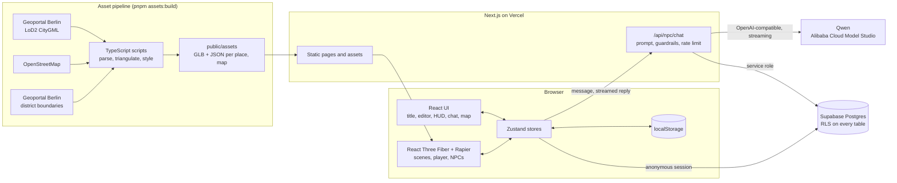

# Berlin Simulator

A cozy lifestyle simulator set in present-day Berlin that runs in the browser, on desktop and phone. Build an avatar, hop between districts on a map of the city, walk around and have free-form conversations with the people you meet. They are played by an LLM. No combat, no score: you collect experiences like "Matcha in Mitte" or "Sunset in Görli".



**The city is real.** Buildings come from Berlin's official 3D city model, streets and trees from OpenStreetMap. **Nothing is hand-modeled.** One command turns open data into three playable places of under 0.5 MB each.

|                                                                      |                                                                       |                                                                                     |
| -------------------------------------------------------------------- | --------------------------------------------------------------------- | ----------------------------------------------------------------------------------- |
|  |  |  |
| Hackescher Markt, Mitte                                              | Görlitzer Park, Kreuzberg                                             | Kurfürstendamm, Charlottenburg                                                      |

More in [`docs/screenshots/`](docs/screenshots), each at 1440x900 and 390x844.

## Features

- **Avatar editor** with live, rotatable preview: build, skin tone, eight hairstyles, clothing and colors.
- **Three places** built from real geodata: a café corner at Hackescher Markt, Görlitzer Park with its central hollow, and Kurfürstendamm by the Memorial Church.
- **Map of Berlin** with all twelve districts; pick a place to travel there.
- **Eight NPCs you can talk to about anything**, each with a personality, local knowledge, a way of speaking (including Berlin dialect) and actions that do something in the game: the barista serves a matcha, the musician plays a song, the student invites you onto his picnic blanket.
- **NPCs remember you**: recent messages plus a model-written summary per player and character.
- **Day-night cycle** with sunsets, lit windows and street lamps; procedural ambient sound per place.
- **Berlin album** with twelve experiences to collect.
- **Third-person controls**: keyboard and mouse on desktop, virtual joystick and touch camera on mobile. German and English UI.
- **Runs without any keys**: no LLM key means canned in-character replies, no database means localStorage.

## How it works



**Asset pipeline.** `scripts/fetch_lod2.ts` finds and downloads the 1 km CityGML tiles covering each place. `scripts/build_buildings.ts` streams the XML, triangulates walls and roofs and bakes plaster and roof colors plus a per-vertex "wall layout" attribute. `scripts/build_place.ts` adds ground, green, water, paths and roads from OpenStreetMap, places trees, benches and lamps, and writes a meshopt-compressed GLB with a JSON manifest. If LoD2 is unavailable, buildings are extruded from OSM footprints instead.

**Rendering.** Buildings ship without textures or normals. A fragment shader draws the whole facade from the wall-layout attribute: plaster, plinth, cornices, and windows with frames, sills, curtains and sky reflections, a random subset lit at night. Paving slabs, asphalt, lawns, leaves and clouds are procedural shaders too. Trees, benches, lamps and background pedestrians are instanced. A quality level (low, medium, high) is chosen from the device and steps down automatically if the frame rate stays low.

**NPC dialogue.** The route handler builds a system prompt from the character's JSON definition, wraps the player's text in delimiters, and streams Qwen's answer. The model replies with JSON (`reply`, `emotion`, `action`); the server extracts the reply text while it streams so words appear immediately, then validates the whole object with Zod. Guardrails run in the prompt and in code: likely injections are flagged, output is checked for prompt leaks and off-limits topics even mid-stream, and anything that fails is replaced by an in-character deflection. Rate limits (per player per hour, global per day) protect the API budget.

**Persistence.** Players sign in anonymously with Supabase. Row level security restricts every table to its owner; NPC memory and rate limits are only written by the server. Every write is mirrored to localStorage, so the game keeps working offline.

Design decisions are logged in [`docs/DECISIONS.md`](docs/DECISIONS.md).

## Tech stack

| Area                 | Tools                                                            |
| -------------------- | ---------------------------------------------------------------- |
| Framework            | Next.js 16 (App Router), React 19, TypeScript (strict), pnpm     |
| 3D                   | three.js, React Three Fiber, drei, Rapier                        |
| State and validation | Zustand, Zod                                                     |
| UI                   | Tailwind CSS 4                                                   |
| LLM                  | Qwen via the OpenAI-compatible API of Alibaba Cloud Model Studio |
| Data                 | Supabase (Postgres, anonymous auth, RLS)                         |
| Assets               | gltf-transform, meshoptimizer, saxes, earcut, proj4              |
| Quality              | ESLint, Prettier, Vitest, Playwright, GitHub Actions             |

## Run it locally

Requirements: Node.js 22 and pnpm 10.

```bash
pnpm install
pnpm dev
```

Open <http://localhost:3000>. That is all: without keys the game runs in mock mode with localStorage.

To use the real services, copy `.env.example` to `.env.local` and fill it in. [`docs/SETUP.md`](docs/SETUP.md) walks through Supabase, Qwen and Vercel step by step.

```bash
pnpm check          # lint, typecheck, unit tests
pnpm test:e2e       # Playwright: builds the app and plays through it on desktop and mobile
pnpm assets:build   # re-download open data and rebuild everything in public/assets
pnpm screenshots    # refresh docs/screenshots (needs a running server)
```

## Project layout

```
app/                 routes: /, /avatar, /play, /about, /api/npc/chat
components/          React UI: title, editor, HUD, chat, map, about
game/                scenes, player controller, NPCs, sky, audio, stores
content/             places and NPCs as JSON, validated with Zod
lib/                 prompt building, guardrails, parsing, Qwen client, Supabase, rate limit
scripts/             asset pipeline
supabase/migrations/ database schema with RLS
tests/               unit (Vitest) and end-to-end (Playwright)
docs/                brief, plan, progress, decisions, setup, screenshots
```

## Data and licenses

- Buildings: Geoportal Berlin, "3D-Gebäudemodelle im Level of Detail 2 (LoD 2)", Datenlizenz Deutschland – Zero – Version 2.0.
- District boundaries: Geoportal Berlin, "ALKIS Berlin Bezirke", Datenlizenz Deutschland – Zero – Version 2.0.
- Streets, paths, green, water, trees, benches, lamps: © OpenStreetMap contributors, ODbL.
- Characters, props and sound are procedural code from this repository. No third-party models, textures or audio.

Details in [`public/assets/LICENSES.md`](public/assets/LICENSES.md). All people, cafés and shops in the game are invented.

This is a non-commercial portfolio project.
